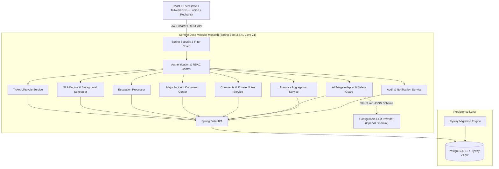
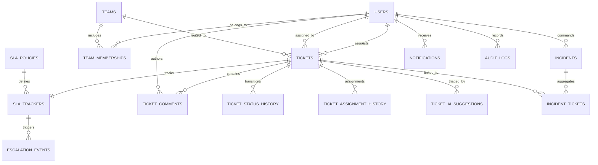

# SentinelDesk AI — Support Ticket & Incident Management Platform

[](https://openjdk.org/projects/jdk/21/)
[](https://spring.io/projects/spring-boot)
[](https://react.dev/)
[](https://www.typescriptlang.org/)
[](https://vitejs.dev/)
[](https://tailwindcss.com/)
[](https://www.postgresql.org/)
[](https://opensource.org/licenses/Apache-2.0)

**SentinelDesk AI** is a production-grade IT Support Ticket and Major Incident Management System engineered for enterprise IT Service Management (ITSM). It combines a high-precision **SLA enforcement engine**, **AI-assisted ticket triage**, **automated breach escalation**, **role-based access control (RBAC)**, and **real-time operational analytics**.

---

## Architecture Overview



---

## Database ER Diagram



---

## Core Capabilities & Engineering Highlights

### 1. Robust Ticket Lifecycle & State Machine
- Strict status transitions: `NEW -> TRIAGED -> OPEN -> IN_PROGRESS -> PENDING_REQUESTER -> RESOLVED -> CLOSED`.
- Invalid transitions are rejected with HTTP 422 (`InvalidStatusTransitionException`).
- Reopening is permitted strictly from `RESOLVED` back to `OPEN`.
- Atomic concurrent-safe ticket sequence generator (`SD-YYYY-NNNNNN`).

### 2. SLA Engine & Background Escalation
- Priority-based targets:
  - **P1 (Critical)**: First response within **15 minutes**; resolution target **4 hours**.
  - **P2 (High)**: First response within **1 hour**; resolution target **8 hours**.
  - **P3 (Medium)**: First response within **4 hours**; resolution target **2 business days**.
  - **P4 (Low)**: First response within **24 hours**; resolution target **5 business days**.
- Continuous background scheduler evaluates SLA tracking records every 30 seconds.
- Triggers `WARNING_80`, `FIRST_RESPONSE_BREACH`, and `RESOLUTION_BREACH` escalation events with instant manager notifications.
- **Zero Duplicate Guarantee**: Database unique constraint on `(ticket_id, escalation_level)` combined with idempotent pre-checks.

### 3. AI-Powered Ticket Triage with Safety Guards
- Uses structured JSON output with validated schemas.
- Produces suggested category, priority, technical domain, team routing, diagnostic questions, troubleshooting actions, and confidence score.
- **Fail-Safe Operation**: If external AI times out or is unconfigured, ticket creation gracefully falls back to deterministic rule-engine triage.
- **Human Oversight**: Staff can accept or override AI suggestions; human overrides mandate written justification and are audited.

### 4. Role-Based & Resource-Level Security
- **RBAC**: Four roles (`ADMIN`, `SUPPORT_MANAGER`, `SUPPORT_AGENT`, `REQUESTER`).
- **Data Isolation**: Requesters are strictly confined to their own tickets.
- **Private Notes Privacy**: `is_internal = true` staff notes are strictly stripped from all requester-facing API responses.

### 5. Incident Command & Correlation
- Group multiple correlated support tickets under a declared Major Incident.
- Track affected service, root cause analysis, and post-incident remediation.

---

## Technology Stack

| Layer | Technologies |
|---|---|
| **Backend** | Java 21, Spring Boot 3.3.4, Spring Web, Spring Data JPA, Spring Security 6, JJWT 0.12.6, Springdoc OpenAPI 2.6.0, Flyway 10, Actuator |
| **Database** | PostgreSQL 16 (production/Docker) / H2 PostgreSQL Mode (local standalone dev), Flyway Migrations |
| **Frontend** | React 18, TypeScript 5.6, Vite 5.4, Tailwind CSS 3.4, Lucide Icons, Recharts 2.12, TanStack Query 5 |
| **Testing** | JUnit 5, Mockito, AssertJ, Spring Boot Test |
| **DevOps** | Docker, Docker Compose, Nginx, GitHub Actions CI Pipeline |

---

## Quick Start Guide

### Prerequisites
- **Java 21 LTS**
- **Node.js 20+** & **npm**

### 1. Run the Backend
```bash
# In the project root:
mvn spring-boot:run -f backend/pom.xml
```
- Server starts on `http://localhost:8080`.
- Swagger UI API documentation: `http://localhost:8080/swagger-ui.html`.
- Flyway migrations `V1` and `V2` run automatically on startup.

### 2. Run the Frontend
```bash
cd frontend
npm install
npm run dev
```
- Open `http://localhost:5173` in your browser.

### 3. Run with Docker Compose
```bash
docker compose up -d --build
```
- Frontend: `http://localhost:3000`
- Backend REST API: `http://localhost:8080`

---

## Demo Accounts

All demo accounts use the standard password: `Password123!`

| Role | Email | Permissions |
|---|---|---|
| **System Administrator** | `admin@sentineldesk.com` | Full system access, audit logs, user administration |
| **Support Manager** | `manager@sentineldesk.com` | Team management, SLA policy config, ticket assignments, escalations |
| **Senior Support Agent** | `agent1@sentineldesk.com` | Ticket triage, internal staff notes, status transitions |
| **Customer Requester** | `user@sentineldesk.com` | Submit tickets, view own tickets, post public replies |

*(One-click instant login buttons are available on the `/login` screen for fast testing).*

---

## Automated Test Results

Run backend test suite:
```bash
mvn test -f backend/pom.xml
```

Actual execution results:
```text
[INFO] Running com.sentineldesk.AiTriageSafetyTest
[INFO] Tests run: 3, Failures: 0, Errors: 0, Skipped: 0
[INFO] Running com.sentineldesk.ConcurrentTicketNumberTest
[INFO] Tests run: 1, Failures: 0, Errors: 0, Skipped: 0
[INFO] Running com.sentineldesk.SecurityAcceptanceTest
[INFO] Tests run: 2, Failures: 0, Errors: 0, Skipped: 0
[INFO] Running com.sentineldesk.SlaEngineTest
[INFO] Tests run: 2, Failures: 0, Errors: 0, Skipped: 0
[INFO] Running com.sentineldesk.TicketWorkflowTest
[INFO] Tests run: 3, Failures: 0, Errors: 0, Skipped: 0
[INFO] 
[INFO] Results:
[INFO] Tests run: 11, Failures: 0, Errors: 0, Skipped: 0
[INFO] BUILD SUCCESS
```

---

## Known Limitations & Future Improvements
1. **Business Hours / Holiday Calendar**: Current SLA deadlines calculate continuously. Future enhancements can incorporate customizable operating hour schedules (e.g. 9 AM - 5 PM Mon-Fri) and regional holiday calendars.
2. **Email Ingestion**: Webhooks and inbound IMAP/SMTP listeners can be connected to convert incoming customer emails into tickets automatically.
3. **WebSocket Live Updates**: Background SLA alerts currently notify via in-app polling; WebSocket/STOMP streaming can be introduced for zero-latency desktop notifications.
