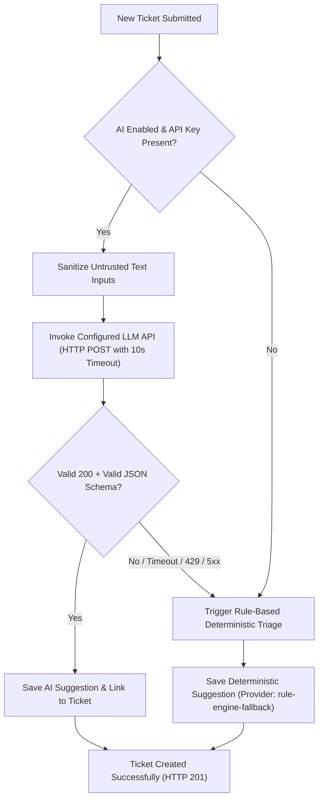

# SentinelDesk AI — AI Triage Subsystem Design

## 1. Objectives & Safety Principles
The AI triage subsystem provides intelligent classification, recommended troubleshooting steps, and suggested team routing. It is designed around four core architectural principles:

1. **Non-Blocking Fault Tolerance**: AI processing failures (network timeouts, rate limits, expired API keys, malformed responses) **must never prevent ticket creation or corrupt ticket data**.
2. **Untrusted Input Protection**: Ticket titles and descriptions are treated as untrusted user input. Any prompt injection attempts are neutralized before prompt assembly.
3. **No Autonomous Production Authority**: The AI subsystem cannot unilaterally close tickets, delete data, modify user permissions, or execute commands on production infrastructure.
4. **Mandatory Human Oversight**: Staff retain complete authority to accept, modify, or override AI recommendations. Human overrides require mandatory explanation and are permanently audited.

---

## 2. Structured JSON Schema
The AI provider returns a validated structured JSON response:

```json
{
  "category": "NETWORK",
  "suggestedPriority": "P2",
  "summary": "Multiple employees disconnected intermittently from EU branch gateway.",
  "suggestedDomain": "Network Infrastructure",
  "suggestedTeam": "Network Operations (NOC)",
  "diagnosticQuestions": [
    "Are all workstations experiencing packet loss simultaneously?",
    "Does restarting the VPN client establish a clean IPsec handshake?"
  ],
  "suggestedActions": [
    "Inspect firewall connection limits on Gateway-EU2.",
    "Verify ISP uplink latency metrics during disconnect spikes."
  ],
  "priorityExplanation": "The incident degrades connectivity for a multi-user regional branch.",
  "confidenceEstimate": 88.5
}
```

---

## 3. Provider Abstraction & Fallback Engine



### Deterministic Rule Engine Fallback
When external LLM APIs are unreachable, disabled, or encounter errors, the `generateDeterministicFallback` algorithm processes keyword matrices:
- **Outage Keywords** (`outage`, `production down`, `database crash`) -> Category `OUTAGE`, Priority `P1`, Team `Cloud & Infrastructure`.
- **Network Keywords** (`vpn`, `dns`, `firewall`, `network`, `wifi`) -> Category `NETWORK`, Priority `P2`, Team `Network Operations (NOC)`.
- **Security Keywords** (`security`, `phishing`, `breach`, `malware`) -> Category `SECURITY`, Priority `P1`, Team `Security Operations (SOC)`.
- **Access Keywords** (`password`, `permission`, `access`, `login`, `mfa`) -> Category `ACCESS`, Priority `P3`, Team `Security Operations (SOC)`.
- **Default Baseline** -> Category `SOFTWARE`, Priority `P3`, Team `Tier 1 Service Desk`.

---

## 4. Human Override Auditing
When an agent or support manager overrides an AI suggestion via `/api/v1/tickets/{id}/ai-triage/{suggestionId}/override`:
- The ticket's active category and priority are updated to the human-specified values.
- `ticket_ai_suggestions.is_overridden` is set to `true`.
- `ticket_ai_suggestions.is_accepted` is set to `false`.
- `ticket_ai_suggestions.human_override_reason` stores the mandatory explanation.
- An immutable audit log entry is written to `audit_logs` linking the actor ID, ticket ID, and explanation.
