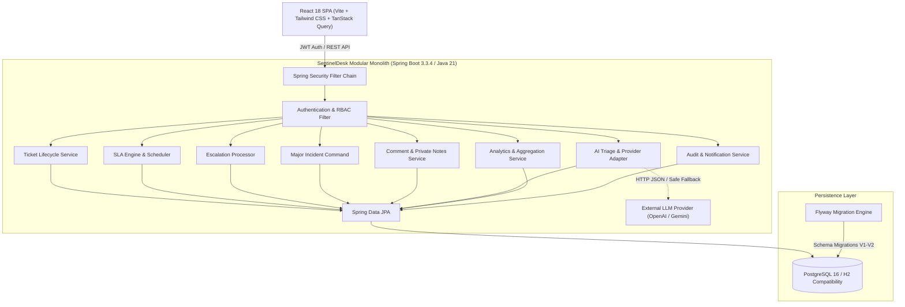

# SentinelDesk AI — System Architecture

## 1. Overview
**SentinelDesk AI** is an enterprise-grade IT Support Ticket and Incident Management Platform built with a **Modular Monolith** architecture. It integrates a deterministic **SLA calculation and escalation engine**, an **AI-powered ticket triage subsystem**, and role-based access control (RBAC).

## 2. Key Modules

### A. Authentication & Security Module
- **JWT (JSON Web Tokens)**: Stateless authentication via `jjwt` 0.12.6 with HS256 / SHA-512 signing.
- **RBAC**: Four distinct user roles: `ADMIN`, `SUPPORT_MANAGER`, `SUPPORT_AGENT`, and `REQUESTER`.
- **Resource Ownership Verification**: Requesters are strictly constrained to view and edit only their own tickets. Internal support notes are filtered out of all requester-facing endpoints.

### B. Ticket Lifecycle Engine
- State machine enforcing valid transitions:
  `NEW -> TRIAGED -> OPEN -> IN_PROGRESS -> PENDING_REQUESTER -> RESOLVED -> CLOSED`
  `CANCELLED`
- Invalid transitions are rejected with HTTP 422 `InvalidStatusTransitionException`.
- Status history and assignment history tables provide complete auditability.

### C. SLA Engine & Background Scheduler
- Calculates **First Response Deadline** and **Resolution Deadline** based on priority rules (`P1`, `P2`, `P3`, `P4`).
- Scheduled background task (`@Scheduled` every 30s) scans active tickets:
  - Triggers `WARNING_80` when 80% of SLA resolution window has elapsed.
  - Triggers `FIRST_RESPONSE_BREACH` when first response target is missed.
  - Triggers `RESOLUTION_BREACH` when resolution target is missed.
- **Duplicate Prevention Guarantee**: Unique database constraint on `(ticket_id, escalation_level)` combined with idempotent query verification guarantees zero duplicate escalation events.

### D. AI Triage Subsystem
- Untrusted input sanitization to neutralize prompt injection attempts.
- Configurable LLM adapter (OpenAI / Gemini REST endpoints) requesting structured JSON.
- **Failure Tolerance**: If the LLM times out or credentials are unconfigured, deterministic rule-engine triage kicks in instantly. Ticket creation never fails due to AI outages.
- Human review and override auditing: Staff can accept or override AI recommendations with mandatory justification.
