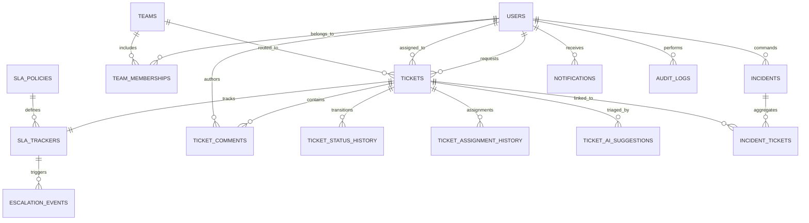

# SentinelDesk AI — Database Design & Schema

## 1. Entity Relationship Diagram

## 2. Table Specifications

### `users`
- `id` (BIGINT GENERATED BY DEFAULT AS IDENTITY PRIMARY KEY)
- `email` (VARCHAR(255) UNIQUE NOT NULL)
- `password_hash` (VARCHAR(255) NOT NULL)
- `full_name` (VARCHAR(150) NOT NULL)
- `role` (VARCHAR(50) NOT NULL: ADMIN, SUPPORT_MANAGER, SUPPORT_AGENT, REQUESTER)
- `department` (VARCHAR(100))
- `is_active` (BOOLEAN DEFAULT TRUE)
- `created_at`, `updated_at` (TIMESTAMP)

### `sla_policies`
- `id` (BIGINT PK)
- `name` (VARCHAR(100) NOT NULL)
- `priority` (VARCHAR(10) UNIQUE NOT NULL: P1, P2, P3, P4)
- `first_response_hours` (NUMERIC(6,2) NOT NULL)
- `resolution_hours` (NUMERIC(6,2) NOT NULL)
- `description` (TEXT)
- `is_active` (BOOLEAN DEFAULT TRUE)

### `sla_trackers`
- `id` (BIGINT PK)
- `ticket_id` (BIGINT UNIQUE FK -> tickets.id)
- `policy_id` (BIGINT FK -> sla_policies.id)
- `first_response_deadline` (TIMESTAMP NOT NULL)
- `first_response_met` (BOOLEAN DEFAULT FALSE)
- `first_response_breached` (BOOLEAN DEFAULT FALSE)
- `resolution_deadline` (TIMESTAMP NOT NULL)
- `resolution_met` (BOOLEAN DEFAULT FALSE)
- `resolution_breached` (BOOLEAN DEFAULT FALSE)
- `is_escalated` (BOOLEAN DEFAULT FALSE)
- `warning_issued` (BOOLEAN DEFAULT FALSE)

### `escalation_events`
- `id` (BIGINT PK)
- `ticket_id` (BIGINT FK -> tickets.id)
- `tracker_id` (BIGINT FK -> sla_trackers.id)
- `escalation_level` (VARCHAR(30) NOT NULL: WARNING_80, FIRST_RESPONSE_BREACH, RESOLUTION_BREACH)
- `reason` (TEXT NOT NULL)
- `status` (VARCHAR(30) DEFAULT 'TRIGGERED': TRIGGERED, ACKNOWLEDGED, RESOLVED)
- `escalated_to_id` (BIGINT FK -> users.id)
- `created_at`, `resolved_at` (TIMESTAMP)
- **Constraint**: `CONSTRAINT uk_ticket_escalation_level UNIQUE (ticket_id, escalation_level)`

### `tickets`
- `id` (BIGINT PK)
- `ticket_number` (VARCHAR(50) UNIQUE NOT NULL)
- `title` (VARCHAR(255) NOT NULL)
- `description` (TEXT NOT NULL)
- `requester_id` (BIGINT FK -> users.id)
- `assigned_agent_id` (BIGINT FK -> users.id)
- `assigned_team_id` (BIGINT FK -> teams.id)
- `category` (VARCHAR(50) NOT NULL)
- `priority` (VARCHAR(10) NOT NULL)
- `status` (VARCHAR(30) NOT NULL)
- `source` (VARCHAR(30) DEFAULT 'WEB')
- `first_response_at`, `resolved_at`, `closed_at`, `sla_deadline` (TIMESTAMP)
- `resolution_summary` (TEXT)
- `related_incident_id` (BIGINT FK -> incidents.id)

### `ticket_comments`
- `id` (BIGINT PK)
- `ticket_id` (BIGINT FK -> tickets.id)
- `author_id` (BIGINT FK -> users.id)
- `content` (TEXT NOT NULL)
- `is_internal` (BOOLEAN NOT NULL DEFAULT FALSE)
- `created_at`, `updated_at` (TIMESTAMP)

### `ticket_ai_suggestions`
- `id` (BIGINT PK)
- `ticket_id` (BIGINT FK -> tickets.id)
- `suggested_category`, `suggested_priority`
- `summary`, `suggested_domain`, `suggested_team`
- `diagnostic_questions_json`, `suggested_actions_json`
- `priority_explanation`, `confidence_estimate`
- `model_provider`, `model_name`
- `is_accepted`, `is_overridden`, `human_override_reason`
- `overridden_by_id` (BIGINT FK -> users.id)

## 3. Flyway Migrations
1. `V1__init_schema.sql`: Initial DDL definitions, primary keys, foreign key constraints, and performance indexes.
2. `V2__seed_initial_data.sql`: Base SLA policies (P1-P4), standard operational teams, and test users.
