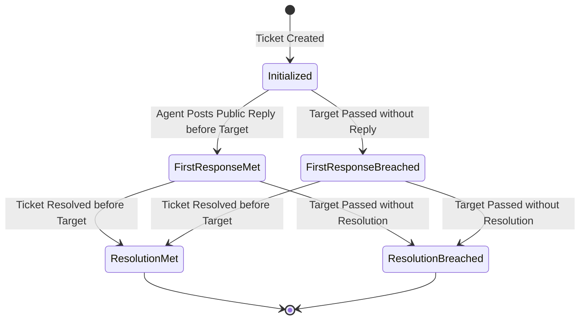

# SentinelDesk AI — SLA Calculation & Escalation Engine

## 1. SLA Policy Targets

| Priority | Level | First Response Target | Resolution Target | Business Impact |
|---|---|---|---|---|
| **P1** | Critical Outage | **15 minutes** (0.25h) | **4 hours** (4.0h) | Core business services down; widespread disruption |
| **P2** | High Degradation | **1 hour** (1.0h) | **8 hours** (8.0h) | Major functionality degraded; no immediate workaround |
| **P3** | Medium Impact | **4 hours** (4.0h) | **2 business days** (48.0h) | Normal operational issues; localized impact |
| **P4** | Low / Request | **1 business day** (24.0h) | **5 business days** (120.0h) | Routine service requests, cosmetic bugs, questions |

*Targets are persisted in `sla_policies` and configurable by managers via `/api/v1/sla/policies/{id}`.*

---

## 2. SLA Tracker Lifecycle

### Measurement Definitions
- **First Response Time**: Measured from `ticket.created_at` to the timestamp of the first public reply added by an authorized support agent or when status transitions to `OPEN`/`IN_PROGRESS`.
- **Resolution Time**: Measured from `ticket.created_at` to `ticket.resolved_at` (recorded when status changes to `RESOLVED`).

---

## 3. Background Escalation Scheduler
A background scheduler (`@Scheduled(fixedDelay = 30000)`) runs every 30 seconds:

1. **Resolution Breach Check**:
   - Compares `LocalDateTime.now()` against `sla_tracker.resolution_deadline`.
   - If `now > deadline` and `resolution_met == false`:
     - Checks if `existsByTicketIdAndEscalationLevel(ticketId, RESOLUTION_BREACH)`.
     - If not, triggers `RESOLUTION_BREACH` escalation event, marks `resolution_breached = true`, and dispatches alert notification to the support manager.

2. **First Response Breach Check**:
   - Compares `now` against `sla_tracker.first_response_deadline`.
   - If `now > deadline` and `first_response_met == false`:
     - Checks if `existsByTicketIdAndEscalationLevel(ticketId, FIRST_RESPONSE_BREACH)`.
     - If not, triggers `FIRST_RESPONSE_BREACH` escalation event.

3. **80% SLA Warning Threshold**:
   - Calculates elapsed duration against total window.
   - If `>= 80%` elapsed and ticket is un-resolved:
     - Dispatches `WARNING_80` alert so technicians can expedite remediation before a breach occurs.

---

## 4. Duplicate Prevention & Idempotency
Duplicate escalations under repeated background execution are prevented via a dual-layer mechanism:
1. **Application-level Idempotency**: Prior to creating an event, the service queries `existsByTicketIdAndEscalationLevel(ticketId, level)`.
2. **Database Constraint**: `CONSTRAINT uk_ticket_escalation_level UNIQUE (ticket_id, escalation_level)` guarantees at the database engine level that no race condition or concurrent run can insert duplicate records.
